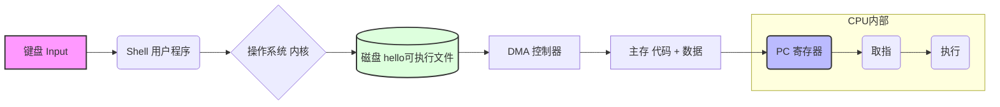

# CSC 3060

# Chapter 1: Introduction

1. Prerequisites

   > - Moore’s law (1975):
   >   - the **number of transistors** on a microchip would **double** about every two years, though the cost of computers would be halved.
   >   - Each time the **cost or performance** improves by **10x**, new applications emerge. 
   > - **Computer Architecture** determines how those transistors are used to achieve high performance effectively
   >   - Multiplier/Divider, Pipelining, Superscalar/VLIW/Out-of-Order, Multi-cores, Cache hierarchy, Vector/SIMD units
   > - **Classes of Computers** 
   >   - Supercomputers, Warehouse-Scale Computers, Servers/Mainframes, Desktop computers (PC/Workstations), Embedded computers, Mobile computers (cell phones, pads, tablets, PDA)
   > - How the components of a computer system work? How they affect the *correctness* and *performance* of your programs?
   >   - architectures, micro-architectures, system programs (OS, Compilers, Linkers,…), and networking

2. ==**A computer system**== consists of ==hardware and system software== that work together to run application programs.

## **1.1 Information is bits + context**

- Memory is usually addressed by **bytes** (8bits), though some machines may use **word** (32bits) or **double word** (64bits) addressing.
  - 0x0000: integer 0, or a NOP instruction, a floating point value +0.0, a memory address, or a sequence of characters.
- Characters are represented in **7 bits (ASCII code), or 8 bits (extended ASCII)**
- 

## **1.2 Program Compilation**：4 Phases 


1. **Pre-processing:**  handles include/define, strips off comments, and conditional compilation `#ifdef`. 
2. **Compiling:** scan/parse/semantic check/code gen/opt .
3. **Assembling:** from assembly to machine code
4. **Linking:** relocation, reference resolution

> ```c++
> // simple.c
> int add(int a, int b) {
>  return a + b;
> }
> 
> int main() {
>  int x = 3;
>  int y = 4;
>  int z = add(x, y);
>  return z;
> }
> ```
>
> ### 1. 预处理
>
> `hello.i`: 经过预处理后，`stdio.h` 的内容会被展开到文件中，宏 `MAX` 会被替换为 `100`，宏`#ifdef` 部分会被根据条件选择性地保留或删除。
>
> ### 2. 编译
>
> - 进行**语法分析**：检查代码是否符合C语言语法
> - 进行**语义分析**：检查类型是否匹配等
> - 进行**优化**：如常量折叠、死代码消除等
>
> ```asm
>     .globl add
> add:
>     add     a0, a0, a1   # a0 = a0 + a1
>     ret
> ```
> ```asm
>     .globl main
> main:
>     addi    sp, sp, -16      # 开栈，I型        0xFF010113
>     sw      ra, 12(sp)       # 保存返回地址，S型 0x00A12623
>     
>     li      t0, 3
>     sw      t0, 8(sp)
>     li      t0, 4
>     sw      t0, 4(sp)
>     # 调用 add(x, y)
>     lw      a0, 8(sp)        # a0 = x         0x00812503
>     lw      a1, 4(sp)        # a1 = y
>     jal     add              # 调用 add
>     sw      a0, 0(sp)        # z = 返回值
>     lw      a0, 0(sp)        # 返回值放进 a0
>     # 函数收尾
>     lw      ra, 12(sp)
>     addi    sp, sp, 16
>     ret                      # jalr x0, ra, 0, 0x00008067
> ```
>
> ### 3. 汇编
>
> 汇编器只做三件事：
>
> 1. 每条指令 → 32 位机器码
> 2. 记住符号名字
> 3. 给链接器留纸条（重定位）
>
> ```asm
> add a0, a0, a1
> 0000000 01011 01010 000 01010 0110011
> 0x00B50533
> ```
>
> | 字段          | 含义            |
> | ------------- | --------------- |
> | opcode        | 0110011（R 型） |
> | rd            | a0              |
> | rs1           | a0              |
> | rs2           | a1              |
> | funct3/funct7 | add             |
>
> ⚠️ `jal add`这里非常重要：
>
> - **汇编阶段还不知道 `add` 在哪**；所以机器码里是：opcode + 占位偏移 + **外加一条“重定位记录”**
>
> ```
> 0x000000EF
> ```
>
> 👉 真正的跳转偏移 **要等第 4 步链接才能填**
>
> ```bash
> hello.o
> ├── .text        # 机器码（上面那些 0x...）
> ├── .symtab      # add, main 的符号
> ├── .rel.text    # jal add 的重定位信息
> └── ELF 头
> ```
>
> 👉 **`.o` 还能不能跑？**❌ 不能
>  👉 **为什么？**`jal add` 还没填地址 & `main` 从哪开始没人知道
>
> ### 4. 链接
>
> #### ① 给每个函数一个“最终地址”
>
> ```asm
> main 在 0x10000
> add  在 0x10040
> ```
>
> #### ② 回头修补机器码（重定位）
>
> 链接器会找到 `.o` 里那条`jal add`，然后：
>
> - 计算`偏移 = add地址 - 当前指令地址`，如`offset = 0x30`
> - 把这个偏移：填进 `jal` 的机器码里
>
> #### ③ 把所有东西合并成一个`a.out`
>
> ### 5. 汇总
>
> ```bash
> gcc -E hello.c -o hello.i # cpp hello.c > hello.i
> gcc -S hello.i -o hello.s # cc1 hello.i
> gcc -c hello.s -o hello.o # as hello.s -o hello.o
> gcc hello.o -o hello
> # 或者
> gcc hello.c -o hello # ld hello.o ... -lc -startfiles ...
> ```

## 1.3 It Pays to Understand How Compilation Systems Work

**Understanding how the compiler translates code:**

- Is "switch" always faster than a nested "if-then-else"?

  - **No. Not always.** 👉 **性能取决于编译器生成的汇编，而不是语法本身。**
  - 如果 `case` 值**连续且密集**：
    - 编译器可能生成 **跳转表（jump table）**
    - 时间复杂度接近 **O(1)**，通常比 `if-else` 快
  - 如果 `case` **稀疏或数量少**：
    - 编译器会把 `switch` 转换成 **条件跳转链**
    - 性能与 `if-else` 相当甚至更慢

- What is the overhead for a function call?

  - 函数调用的开销主要来自：
    - 参数传递，保存/恢复寄存器，跳转和返回（`call / ret`），栈帧管理
  - **优化方式：**📌 `inline` 是**建议**，现代编译器会自动决定是否内联。
    - 对小函数，编译器可进行 **内联（inline）**
    - 内联后：消除函数调用开销，提高寄存器优化和指令调度机会。

- Why is `(a+b)+(c+d)` faster than `(((a+b)+c)+d)`? parallel

- Why is `memcpy(*restrict dest, *restrict src,…)` much faster than without `restrict`?

  - 编译器无需担心 **别名（aliasing）**

  - 可以：使用向量化指令，重新排序内存访问，使用更激进的优化

**Compiler optimization flag (-O):** The performance loss without it might be 2x–20x，`-O0 / -O1 / -O2 / -O3`：逐步增强优化强度。否则：

- 无内联 / 无常量折叠 / 无死代码消除 / 无循环优化

**Linker knowledge:**

- How do you resolve linker-reported error messages?

  - **Undefined reference**：函数声明了但未定义 / 忘记链接库（如 `-lm`）
  - **Multiple definition**：同一个符号在多个 `.o` 文件中定义
  - **库顺序错误**：库应放在依赖它的对象文件之后

  👉 解决方法：

  - 检查函数是否真正实现 / 确认链接了正确的库 / 调整链接顺序

- What is the difference between static and dynamic libraries?

  | 静态库                 | 动态库         |
  | ---------------------- | -------------- |
  | 链接时复制进可执行文件 | 运行时加载     |
  | 可执行文件更大         | 文件更小       |
  | 无运行时依赖           | 依赖系统库     |
  | 更新库需重新编译       | 更新库无需重编 |

**Security:** To avoid security holes in your program, you must understand how data and control information are stored on the program stack.

- 栈上存放：局部变量，返回地址，保存的寄存器

- 如果程序存在：缓冲区溢出，不安全的内存操作

- 攻击者可能：覆盖返回地址，劫持控制流（如栈溢出攻击）

## **1.4 Processors Read and Interpret** **Insts** **Stored in Memory**

1. Shell is a command line interpreter

   ```bash
   ./hello
   hello, world
   ```

### 1.4.1 Hardware Organization of a Computer System

- **Buses** — carry information between components
  - ==总线是一种“共享的通信协议 + 互连结构”，允许多个组件共享一组通信通道==。
  - 它回答三个问题：
    1. **谁**在通信？（CPU / 内存 / I/O）
    2. **怎么**通信？（读 / 写 / 控制）
    3. **什么时候**轮到谁？（仲裁）
  - 1️⃣ 地址总线（Address Bus）`地址 = 0x1000`
  - 2️⃣ 数据总线（Data Bus）`data = 0x12345678`
  - 3️⃣ 控制总线（Control Bus） `读/写 信号`
- **I/O devices** — keyboards, displays, disks, network adapters, etc.
- **Main Memory** — holds data and instructions
- **CPU (Processor)** — contains Register file, PC (program counter), and ALU (arithmetic/logic unit); connected via System bus and Memory bus through an I/O bridge 
  - ==CPU 是解释（执行）存储在主存中指令的引擎。==
  - ==PC 是一个“一个字大小”的寄存器，存放的是“下一条要执行的指令的地址”。==
  - 执行一条指令包含一系列步骤：
    1. **取指（fetch）**
        从 `PC` 指向的内存读指令
    2. **译码（decode）**
        解释指令的位含义
    3. **执行（execute）**
        做加载（load）/ 存储（store）/ 操作（operate）/ 跳转（jump）
    4. **更新 PC**
  - ==寄存器文件 = 一组字长寄存器的集合，每个有名字。==
  - **Bus interface**
    1. **协议转换**: CPU 内部（同步、超快） vs 外部总线（有等待、有仲裁）
    2. 请求排队与仲裁
    3. **数据缓冲**：CPU 快、内存慢
- **I/O bridge**：把一种总线协议，翻译成另一种总线协议

### 1.4.2 Running the "Hello" Program

1. The processor begins executing the machine-language instructions in the "hello" program's main routine. These instructions copy the bytes in the `hello, world\n` string **from memory to the register file**, and **from there to the display device**.




## 1.5 Caches Matter

- **Temporal locality** — If data A is referenced, it is likely to be referenced again in the near future. Instructions in a loop are likely to be executed again and again.
- **Spatial locality** — If data A is referenced, its nearby neighbors, such as A+1, A+2, and A-1, A-2, are likely to be referenced again in the near future.

## 1.6 Storage Devices Form a Hierarchy

| Level | Storage                                                      | Description                                               |
| ----- | ------------------------------------------------------------ | --------------------------------------------------------- |
| L0    | Registers （==Small, Fast, Expensive==）                     | CPU registers hold words retrieved from cache memory      |
| L1    | L1 cache (SRAM)                                              | Holds cache lines retrieved from L2 cache                 |
| L2    | L2 cache (SRAM)                                              | Holds cache lines retrieved from L3 cache                 |
| L3    | L3 cache (SRAM)                                              | Holds cache lines retrieved from memory                   |
| L4    | Main memory (DRAM)                                           | Holds disk blocks retrieved from local disks              |
| L5    | Local secondary storage (local disks)                        | Holds files retrieved from disks on remote network server |
| L6    | Remote secondary storage (distributed file systems, Web servers) （==Large, Slow, Cheap==） | —                                                         |

## 1.7 OS Manages the Hardware

- Making the machine easier to use by applications (GUI, Shell, Touch Screen interface, …)
- Resource manager and allocator (memory, CPU, I/O)
- Controller of the system hardware (various schedulers: processor, IO, memory, network, device, ..)
- Security and Protection

==Applications use **system calls** to request operating system services for interacting with I/O devices (一次受控的 CPU 特权级切换).==


### 1.7.0 Three OS Abstractions (Virtualization)


**Virtualization** is often related to multiplicity, fake versions, and sharing. For example:

1. Only **one physical memory**, but it can be shared by many virtual address spaces (Virtual Memory). 👉 **空间的虚拟化**
2. Only **one CPU**, but it can be shared by many processes. 👉 **时间的虚拟化**
3. Only **one machine**, but it can be shared by multiple OSes at the same time (Virtual Machines). 👉 **设备的虚拟化**

### 1.7.1 Processes

==A *process* is the operating system's abstraction for a running program.==

-  **Context switching**: A single-core can appear to execute multiple processes concurrently by having the processor switch among them. 
- **Context**: The OS keeps track of all the *state information* that the process needs to run. (e.g., PC, registers, flags).

### 1.7.2 Threads

==A process consist of multiple execution units, called **threads**, each running in the context of the process and *sharing the same code and global data*.==

A thread is a light-weight process, with **Pros**:

| Processes      | Threads            |
| -------------- | ------------------ |
| High isolation | Low overhead       |
| More secured   | Fast communication |
| Scalable       | Efficient          |

### 1.7.3 Virtual Memory


==*Virtual memory* is an abstraction that provides each process with the illusion that it has exclusive use of the main memory.==

- Each process has its own *virtual address space*.
- The highest address space is for the OS kernel.
- The address 0's ==page (4KB)== is not used — this is to prevent NULL pointer dereferences.


**Main Memory as a Cache for VM:**

- Virtual address space can be greater than the physical memory. **64-bit address space**, but a **48-bit physical address space**.

- **RAM = VM 的 cache.** Virtual address space is allocated on disk, and pages are dynamically moved to memory as needed (cheaper).

- Supports **multiprogramming**: multiple processes can coexist on the same system. 

  👉 OS 可以：只保留活跃进程的页 & 把不活跃进程的页换出到磁盘

- **虚拟内存 + 进程 = CPU 不会空转。**When one process is doing I/O, OS schedules another.

- Allows multiple processes to **share data**: map different virtual pages to the same physical page. For example, a shared library can be implemented that way.


### 1.7.4 Files

- ==A *file* is a sequence of bytes, modelling Every I/O device.==

- All input and output in the system is performed by reading and writing files, using a small set of system calls known as **Unix I/O**: `Open()`, `Close()`, `Read()`, `Write()`, `Lseek()`

- It provides applications with a uniform view of all the varied I/O devices that might be contained in the system. 

## 1.8 Systems Communicate with Networks


## 1.9 Important Themes

==A **system** is a collection of intertwined hardware and system software that must cooperate to achieve the goal of running application programs.==

**Several important concepts that cut across all aspects of computer systems:**

- Amdahl's Law
- Concurrency and Parallelism
- Instruction-Level Parallelism
- Single-Instruction, Multiple-Data (SIMD) Parallelism
- Abstractions

### 1.9.1 Amdahl's Law

$$
T_{new} = (1 - \alpha) \cdot T_{old} + \alpha \cdot \frac{T_{old}}{k}
$$

$$
\text{Speedup} = \frac{1}{(1-\alpha) + \frac{\alpha}{k}}
$$

-  Focus optimizations on the most time-consuming part.
- (If there is a significant fraction of time (say, β) on serial code, parallelization has little impact since the best speedup achievable is only **1/β**.

------

### 1.9.2 Concurrency and Parallelism 👉 **并行一定是并发的，但并发不一定并行**

**Concurrency** refers to the general concept of a system with **multiple, simultaneous activities**.

- *Example:* A time-sharing system where multiple users are using the same system. Multiprogramming: On a single-core system, multiple programs coexist in memory at the same time, but only one can run on the CPU.

**Parallelism** refers to the use of concurrency to make a system run faster. (**“真正同时执行多个活动”的能力**)

- *Example:* Using 4 CPU cores to process 4 parts of an image at the same time. 

------

### 1.9.2 ILP and DLP

- **Instruction-level parallelism (ILP): execute multiple instructions at one time in one thread**.
  - Micro-architecture techniques such as pipelining, superscalar, and out-of-order execution exploit ILP to speed up instruction processing.

- **Data-level parallelism (DLP)**: DLP 指的是对多份数据执行同一条指令。`for (i = 0; i < 4; i++) C[i] = A[i] + B[i];`

- **SIMD** (Single Instruction Multiple Data) and Vector instructions exploit DLP.
- **GPU** (e.g., NVIDIA GPU) is another type of DLP machines.

## 1.10 Summary

- A computer system consists of hardware and system software.
- Information inside the computer is represented as groups of bits.
- Programs are compiled into machine instructions in a binary executable.
- Processors read and interpret binary instructions.
- Computers spend most of the time copying data, so the memory/storage hierarchy is critical to performance.
- The OS kernel serves as an intermediary between the application and the hardware. It provides three abstractions: (1) Files, (2) Virtual memory, and (3) Processes.
- Networks provide ways for computer systems to communicate with one another.
