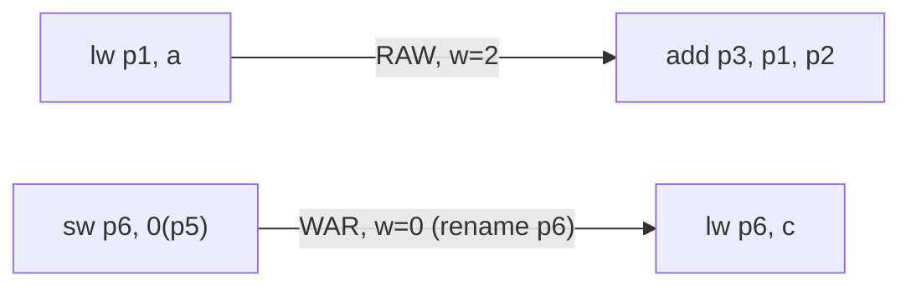

# Lec 4.5: Code (Instruction) Scheduling

## Exam Facts

==**Code scheduling**==: find a topological sort of the **dependence DAG** that minimizes stalls, without changing program meaning. Worst case 50 indep instrs → **50!** schedules → use list-scheduling heuristics.

- ==**Dependence DAG**==: node = instr; edge = required order; weight = producer latency (RAW) / 0 (WAR, WAW).

- ==**3 register dependences**==:

  | Type    | Meaning                                                           | Hazard?         | Removable?            |
  | ------- | ----------------------------------------------------------------- | --------------- | --------------------- |
  | **RAW** | reader needs producer's value (==**true dep**==)                  | ✅              | ❌ — must keep order  |
  | WAR     | later writer overwrites a reg an earlier reader still needs       | order-only      | ✅ **rename**         |
  | WAW     | two writes to same reg; last one must win                         | order-only      | ✅ **rename**         |
  | RAR     | both read same reg                                                | ❌              |                    |

- **Memory edges from aliasing**: cannot reorder L/S unless **non-aliasing proven** (distinct stack offsets, `restrict`, proven non-overlap arrays, no `volatile`/IO/call/trap). Otherwise add conservative memory-order edges.

- **Compiler scheduling limits**: memory aliasing, unknown mem latency (cache hit/miss), scope shrunk by branches/calls/traps/volatile/IO.

- **Schedule count** (50-instr block): full dep chain → **1**; all independent → **50!**.

- ==**Critical path / MD**== (longest weighted path from `n` to a leaf, computed by reverse topo):

  $$
  MD(n) = \max_{n \to c}\big(\text{weight}(n,c) + MD(c)\big); \quad \text{leaf: } MD = 0 \text{ or } latency(n)
  $$

  > Schedule critical-path nodes **early**.

- ==**List-scheduling tie-break**== (strict order):
  1. ==**no stall now**== — pick a different ready op rather than stall
  2. **larger MD** (protect critical path)
  3. original program order
  4. more children
  5. final use of a reg (shrink live range)

- **Operation latencies** (arc weights):

  | Op          | int ALU | load (hit) | int mul | FADD | FMUL | FMA | **int div** |
  | ----------- | ------- | ---------- | ------- | ---- | ---- | --- | ----------- |
  | **Latency** | 1       | 2-3        | 3-5     | 3-4  | 4-5  | 5-6 | **~32**     |


## 1. Building the Dependence DAG

> Skip `x0` as destination (no real dep).



**WAR / WAW remove by renaming**:

```asm
sw p6, 0(p5);  lw p6, c     # WAR: rename second p6 → p6'
lw p1, a;      lw p1, c     # WAW: rename second p1 → p1'
```

## 2. Memory Aliasing

```asm
sw x5, 0(x1)
lw x6, 0(x2)    # ❌ cannot move before store if x1 may == x2
sw x6, 0(x2)    # ❌ cannot swap stores if x1 may == x2
```

> [!IMPORTANT]
> If aliasing **cannot be ruled out**, the DAG must add memory-order edges — these limit reorderings to a conservative subset.

## 3. Critical Path via MD (Reverse Topo)

$$
MD(n) = \begin{cases}
latency(n), & \text{no successors (leaf)} \\
\max_{n \to c}(\text{weight}(n, c) + MD(c)), & \text{otherwise}
\end{cases}
$$

$$
priority(n) = \begin{cases}
latency(n) & \text{if } n \text{ has no successors} \\
\max \begin{cases} 
latency(n) + \max\limits_{s \in RAW\_succ(n)} priority(s) \\
\max\limits_{s \in WAR/WAW\_succ(n)} priority(s) 
\end{cases} & \text{otherwise}
\end{cases}
$$

> Convention: if node latency lives in the **outgoing edge**, leaf MD = 0; if MD includes the node's own latency, leaf MD = latency. Be consistent.

```cpp
int CP(int n) {                       // O(N+E)
    if (visited[n]) return MD[n];
    visited[n] = true;
    int lat = inst[n].latency;
    if (succ[n].empty()) return MD[n] = lat;
    int maxRAW = 0, maxOrder = 0;
    for (auto& e : succ[n]) {
        int s = CP(e.target);
        if (e.type == RAW) maxRAW   = max(maxRAW,   s);
        else               maxOrder = max(maxOrder, s);
    }
    return MD[n] = max(lat + maxRAW, maxOrder);
}
```

## 4. List Scheduling

```text
1. Build DAG.
2. Compute MD per node (reverse topo).
3. Ready list = preds scheduled AND RAW latency satisfied.
4. Each cycle, pick best ready by tie-break order.
5. Issue; update ready list; advance cycle.
```

> [!IMPORTANT] 
> If a ready arith op would stall now (waiting on load/mul RAW), pick a **different independent ready op** to fill the bubble.

**Worked example** (loads = 2 cy, mul = 3 cy, add = 1 cy):


| Step | Ready    | Pick               | Reason                                              |
| ---- | -------- | ------------------ | --------------------------------------------------- |
| 1    | {1,2,9}  | **1** `lw $pr1,a`  | tied MD=7 → original order first                    |
| 2    | {2,9}    | **2** `lw $pr2,b`  | MD=7, no stall                                      |
| 3    | {3,5,9}  | **9** `lw $pr7,d`  | 3 & 5 await 1/2 (2-cy load) → fill with 9           |
| 4    | {3,5}    | **3** `add $pr3`   | 1 ready; MD(3)=5 > MD(5)=3                          |
| 5    | {4,5}    | **4** `mul $pr4`   | MD(4)=4 > MD(5)=3                                   |
| 6    | {6,10,5} | **5**              | 6 must wait 3 cy for mul → pick 5                   |
| 7    | {6,10,8} | **8**              | 6, 10 still waiting → fill with 8                   |

## 5. Quiz 2 Reorder Problem

==**Quiz 2 sequence (no forwarding) → 9 bubbles**==:

```asm
1. LW S1, 8(S0)
2. LW S2, 16(S0)
3. SUB T4, S2, S1     ← 2 bubbles (RAW on S2/S1)
4. AND T5, T4, T3     ← 2 bubbles (RAW on T4)
5. SUB S4, T4, T3     ← 0 (T4 already bubbled by 4)
6. ADD T6, S4, T4     ← 2 bubbles (RAW on S4)
7. SW T6, 4(S7)       ← 2 bubbles (RAW on T6)
8. LW S3, 24(S7)
9. LW S1, 8(S7)
10. LW S5, 32(S0)
11. ADD T7, S3, S1    ← 1 bubble (RAW on S1, 1 cy apart)
12. LW S6, 64(S0)
```

**With forwarding: 2**

**Reordered** (fill load-use gaps + rename to free `S1`):

```asm
1.  LW S1, 8(S0)
2.  LW S2, 16(S0)
8.  LW S3, 24(S7)         # moved up; fills 2-cy load gap before instr 3
9.  LW S8, 8(S7)          # renamed S1 → S8 (original S1 still needed at 11)
3.  SUB T4, S2, S1
10. LW S5, 32(S0)
11. ADD T7, S3, S8        # uses renamed S8
4.  AND T5, T4, T3
5.  SUB S4, T4, T3
12. LW S6, 64(S0)
6.  ADD T6, S4, T4
7.  SW T6, 4(S7)
```

> [!IMPORTANT]
> ❌ Cannot move loads 10/12 before instr 7's store unless `S0+32`, `S0+64` proven non-aliasing with `S7+4`.
> ✅ Renaming `S1 → S8` required: without it, the new `S1` from instr 9 would clobber the original `S1` consumed at instr 3 (WAW + WAR violation).
