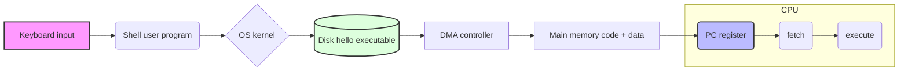

# Lec 1: Introduction

## Exam Facts

- ==**Computer system**==: **hardware + system software** that run application programs.
- ==**Computer architecture**==: **interface between SW and HW**; broad sense = `ISA + microarchitecture + system design`. *Not* "the components" or "rules a programmer must follow" alone.
- **System programs**: `OS`, compiler, assembler, linker, loader.
- ==**Moore's Law (1975)**==: transistor count roughly doubles every **2 years**; architecture decides how to turn transistors into perf/cost/energy wins (pipeline, OoO, multicore, cache, SIMD/vector).
- ==**Bits + context**==: same bits → `int` / FP / instruction / address / char bytes / array/struct fields.
- **Character encoding**: **ASCII = 7-bit**; extended ASCII = 8-bit; C strings store as `'0'=0x30`; terminator `\0=0x00`.
- **128 all-0 bits**: 4 fp32 `+0.0` / 2 fp64 `+0.0` / 1 fp128 `+0.0` / int zeros; **not** ASCII `"0..0"` (those are `0x30` bytes).
- ==**RV32I about**==: 32b addresses (`4 GiB`), byte-addressable, 32 GPRs `x0..x31`; ISA does **not** require on-chip caches.
- ==**RV32 valid extensions**==: base **must be `I` or `E`**; `RV32EM` ✓, `RV32IM` ✓; `RV32MI` ✗ (`M` is not a base), `RV32ME` ✗.
- **`gcc` phases**: `preprocess → compile → assemble → link`; **loading is NOT a gcc phase** (loader/OS does it).
- **Relocatable `.o`**: not executable; unresolved symbol addresses/calls need linker relocation.
- ==**Linker jobs**==: `symbol resolution + relocation + section merging + library handling`.
- **Hardware org**: bus carries `address + data + control`; CPU = **PC + regfile + ALU**; bus interface = protocol-conv + queue/arb + buffering.
- ==**OS abstractions**==: ==**process, virtual memory, file**==. Networks = means of communication, not an OS abstraction.
- ==**ABI**==: **ISA + OS + calling convention**. Binary is portable iff ABI matches.
- **System call**: controlled CPU privilege transfer into kernel for protected OS service, then back.
- **Memory hierarchy illusion**: memory appears **fast + large + inexpensive**.
- **Locality**: ==temporal== (reuse soon) + ==spatial== (neighbors soon).
- **Architecture state must be saved on interrupt** so program can resume; microarch state can be regenerated.

## 1. Information is Bits + Context

- Memory is **byte-addressed**; 1 byte = 8 bits; word = 32b/64b depending on machine.
- Pointer value = **virtual address of first byte**; pointer **type** decides size + interpretation.
- **A bit pattern has no single meaning without context**:

| Bits | Possible meaning |
|---|---|
| `0x00000000` | `int 0` / `fp32 +0.0` / NULs / address `0`; as RV instruction: **illegal** (opcode `0` not allocated) |
| `0x00000013` | RV32I `addi x0,x0,0` (canonical `nop`) |
| `0x00000033` | RV32I `add x0,x0,x0` (no effect); also `int 51`; ASCII `'3'`+NUL bytes |
| `0xffffffff` | `unsigned UMax` / `signed -1` / `fp32 NaN` / top of address space |
| `0x30` | ASCII `'0'` (**not** numeric 0) |

> `"0000"` C-string bytes are `30 30 30 30 00` (ASCII), **not** zero bytes.

## 2. Program Compilation: 4 Phases

| Phase | Tool | Input → output | Main job |
|---|---|---|---|
| Preprocess | `cpp`, `gcc -E` | `.c → .i` | expand `#include`, macros, `#ifdef`, strip comments |
| Compile | `cc1`, `gcc -S` | `.i → .s` | parse / typecheck / optimize / emit assembly |
| Assemble | `as`, `gcc -c` | `.s → .o` | encode to machine code; emit symbols + reloc entries |
| Link | `ld` (via `gcc`) | `.o + libs → exe` | resolve symbols; relocate; merge sections |

```bash
gcc -E a.c -o a.i      # preprocess
gcc -S a.i -o a.s      # compile
gcc -c a.s -o a.o      # assemble
gcc a.o b.o -o prog    # link
```

> Trap: **Loading** (OS putting exe pages into memory) is **NOT** a `gcc` phase.

### 2.1 Object / Link Quick Facts

`.o` (relocatable) commonly contains:

| Section | Use |
|---|---|
| `.text` | machine code |
| `.rodata` | string literals, jump tables, constants |
| `.data` / `.bss` | initialized / zero globals & file-scope statics |
| `.symtab` | symbol definitions/references |
| `.rel.text`, `.rel.data` | places linker must patch |

> Why `.o` can't run: `jal func` still has placeholder offset; `main`'s final address unknown until link.

Common linker errors:

| Symptom | Cause | Fix |
|---|---|---|
| `undefined reference` | def not linked / lib missing | add `.o` or `-lfoo`; check spelling |
| `multiple definition` | dup strong global | one def + `extern` in headers; use `static` for file-local |
| `-lfoo` unresolved | static lib placed before user `.o` | `gcc main.o -lfoo` (libs after consumers) |

### 2.2 Why Compilation Systems Matter

> [!IMPORTANT]
> ==**Syntax ≠ performance**==; judge by generated assembly.

- ==**`switch` vs `if-else`**==: **dense cases** → `jump table` (≈O(1) but indirect-branch hard to predict); **sparse/few cases** → branch chain (similar to if-else, may be slower).
- **Function call overhead**: `arg setup + jal/ret + save/restore live regs + stack frame`; `inline` removes overhead + enables more opt, but may bloat code.
- **Expression reassoc / ILP**: `(a+b)+(c+d)` exposes parallel adds; `(((a+b)+c)+d)` is a serial chain. FP not freely reassociable.
- ==**`restrict`**==: declares no aliasing → compiler can vectorize / reorder memory ops more aggressively (e.g. `memcpy(restrict dst, restrict src,…)` is much faster).
- **`-O`**: missing optimization can cost **2×–20×**.
- ==**ABI**==: **ISA + OS + calling convention**. Binary code not portable across incompatible ABIs (x86/Win exe ≠ ARM/Linux). Text data is portable (ASCII bytes are universal).
- **Static vs dynamic libs**: `.a` copied at link time → big exe, no runtime dep; `.so` loaded at run time → small exe + shared pages, ABI-compat update without relink.
- **Stack security**: stack stores **local data + control info** (`ra`, saved regs, old `fp`); unchecked write → corrupt control flow, hijack.

## 3. Hardware Organization

### 3.1 Components & Execution Cycle

```text
PC → fetch instruction → decode → execute / load / store / branch → writeback → update PC
```

| Component | Role |
|---|---|
| ==**Bus**== | shared interconnect carrying **address + data + control** lines |
| I/O devices | keyboard, display, disk, NIC |
| Main memory | byte array of **instructions + data** |
| ==**CPU**== | engine interpreting instrs; contains **PC + regfile + ALU** |
| **PC** | one-word reg holding **address of next instruction** |
| Regfile | named word-size registers (32 in RV32I) |
| ALU | arithmetic / logic / address calc |
| I/O bridge | translates between bus protocols |

==**Bus interface**== handles:

| Job | Why |
|---|---|
| protocol conversion | CPU is fast/synchronous; external bus has waits/arbitration |
| request queue + arbitration | many agents share channels |
| data buffering | CPU faster than memory/IO |

Bus answers three questions:

| Question | Answer |
|---|---|
| who communicates? | CPU / memory / I/O device |
| what is transferred? | address / data / read-write-control signal |
| who gets bus now? | arbitration |

### 3.2 Running `hello`



==**DMA**==: device/disk moves bytes **directly to/from memory** without per-byte CPU copy; CPU only sets up the transfer.

## 4. Caches and Storage Hierarchy

| Level | Example | Mgmt | Property |
|---|---|---|---|
| L0 | registers | compiler | fastest, smallest, $$$ |
| L1/L2/L3 | SRAM caches | hardware | cache lines from lower level |
| L4 | DRAM | OS+MMU (VM) | main memory |
| L5 | local disk/SSD | OS+app | persistent, slow |
| L6 | remote / DFS | network/app | huge, slow, cheap |

**Locality:**

| Type | Meaning | Example |
|---|---|---|
| ==temporal== | reused soon | loop body instrs, hot var |
| ==spatial== | neighbors used soon | array scan, sequential fetch |

> [!IMPORTANT]
> Memory hierarchy gives the illusion of **fast + large + inexpensive** memory. ("Fast/large/cheap" is the right answer; "the memory space is all yours" is the wrong distractor.)

## 5. OS Manages Hardware

```
┌───────────────────────────────────────┐ 
│          Application programs         │ ┐
├───────────────────────────────────────┤ │ Software
│            Operating system           │ ┘
╞══════════════╤═════════════╤══════════╡ 
│   Processor  │ Main memory │  I/O dev │ ┐ Hardware
└──────────────┴─────────────┴──────────┘ ┘
```

==**Three OS abstractions**==:

```
                 ┌─────────────────── Processes ──────────┐
                 │          ┌─────── Virtual memory ──────┐
                 │          │               ┌─── Files ───┐
  ┌──────────────┴┐┌────────┴────────┐┌─────┴─────────────┴─────┐ 
  │   Processor   ││   Main memory   ││       I/O devices       │ 
  └───────────────┘└─────────────────┘└─────────────────────────┘ 
```

### 5.1 Process & Thread

- ==**Process**==: running program + context (`PC`, regs, address space, OS metadata).
  - **Context switch**: OS swaps process state.
  - **Pros**: high isolation, security, scalability.
- ==**Thread**==: execution stream inside a process; **shares address space + globals**, has **own PC, regs, stack**.
  - **Pros**: low overhead, fast communication, efficient.

==**System call**==: app requests OS service via controlled CPU privilege switch; one mode→kernel mode→back.

### 5.2 Virtual Memory Layout

==**Virtual memory**==: each process sees its own address space. Page-0 unmapped → catches `NULL` deref. Shared libs (`.so`) can map same physical pages into many processes.

```
   /  Higher Address  \
  ┌────────────────────┐
  │Kernel virtual mem  │  (invisible to user)
  ├────────────────────┤
  │     User stack     │  ← grows down (created at runtime)
  │         ▼          │
  ├────────────────────┤
  │   Memory-mapped    │  shared libs (printf, ...)
  │      region        │
  ├────────────────────┤
  │         ▲          │
  │   Run-time heap    │  → grows up (malloc)
  ├────────────────────┤
  │  Read/write data   │  ┐ from .data/.bss
  ├────────────────────┤  │
  │Read-only code/data │  ┘ from .text/.rodata
  ├────────────────────┤
  │         0          │  ← NULL trap zone
  └────────────────────┘
   \  Lower Address   /
```

### 5.3 Files & Virtualization

- ==**Unix I/O / file**==: uniform byte-stream abstraction for disk/terminal/network/etc. Sys calls: `open/close/read/write/lseek`.
- ==**Virtualization**==: one physical resource appears as many. Three flavors:
  - **Space virtualization**: many virtual address spaces share one physical memory (VM).
  - **Time virtualization**: many processes share one CPU (multitasking).
  - **Device virtualization**: many OSes share one machine (VMs / hypervisor).

## 6. Important Themes

### 6.1 Amdahl's Law

If $\alpha$ of old time is improved by factor $k$:

$$
T_{new}=(1-\alpha)T_{old}+\frac{\alpha T_{old}}{k}; \quad
Speedup=\frac{1}{(1-\alpha)+\alpha/k}\le\frac{1}{1-\alpha}
$$

- **Focus optimization on the largest time-consuming part.**

### 6.2 Concurrency vs Parallelism vs ILP/DLP/TLP/MLP

| Term | Meaning | Realized by |
|---|---|---|
| **concurrency** | multiple activities in progress | time-slicing, context switch |
| **parallelism** | actually executing simultaneously | multiple resources |
| ==**ILP**== | many instrs from **one thread** overlap/issue | pipeline, superscalar, OoO, scheduling, branch prediction, non-blocking cache |
| ==**DLP**== / SIMD | same op over many data | SIMD/vector/RVV/sub-word; **GPU is DLP-style** |
| ==**TLP**== | independent threads/tasks in parallel | multicore, SMT/HT, OS threads, , snoopy caches, inclusive caches |
| ==**MLP**== | multiple outstanding memory ops/misses | non-blocking cache + **MSHR**, interleaved DRAM banks, OoO mem |

> [!IMPORTANT]
> **Parallelism ⇒ concurrency, but concurrency does NOT imply parallelism.** Multiprogramming on 1 core = concurrent, not parallel.
