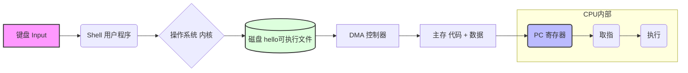

# Lec 1: Introduction

## Exam Facts

- ==**Computer system**==: **hardware + system software** that run application programs.
- ==**Computer architecture**==: **interface between software and hardware**; broader = `ISA + microarchitecture + system design`.
- **System programs**: `OS`, compiler, assembler, linker, loader. **Application**: ChatGPT/browser/game.
- ==**Bits + context**==: same bits can be `int`, FP, instr, address, char bytes, struct fields.
- **Character encoding**: **ASCII = 7-bit**; extended ASCII = 8-bit; Unicode covers many languages.
- **128 all-0 bits**: integer zeros or fp32/fp128 `+0.0`; **not** ASCII `"0000"` (`0x30` bytes).
- **`gcc` phases**: `preprocess -> compile -> assemble -> link`; **loading is not a gcc compilation phase**.
- **Relocatable `.o`**: not executable; unresolved symbol addresses/calls need linker relocation.
- **Linker jobs**: `symbol resolution + relocation + section merging + library handling`.
- **Hardware org**: bus carries `address + data + control`; CPU contains **PC + register file + ALU**; bus interface handles protocol conversion/queueing/buffering.
- **OS abstractions**: ==**process, virtual memory, file**==.
- **System calls**: controlled transfer into kernel for protected OS services.
- **Memory hierarchy illusion**: memory appears **fast + large + cheap**.
- **Amdahl**: speedup is limited by the unimproved fraction.

## 1. Information is Bits + Context

- Memory is byte-addressed; 1 byte = 8 bits.
- Pointer value = virtual address of first byte; pointer type tells how many bytes/how to interpret.
- A bit pattern has no single meaning without context:

| Bits | Possible meaning |
|---|---|
| `0x00000000` | int `0`, fp32 `+0.0`, NULs; as RISC-V instruction: **illegal** |
| `0x00000013` | RISC-V `addi x0,x0,0` (`nop`) |
| `0x30` | ASCII `'0'`, not numeric 0 |

> [!IMPORTANT]
> All-zero bits do **not** mean ASCII zeros. `"0000"` bytes are `30 30 30 30 00`.

## 2. Program Compilation: 4 Phases

| Phase | Tool | Input -> output | Main job |
|---|---|---|---|
| Preprocess | `cpp`, `gcc -E` | `.c -> .i` | expand `#include`, macros, `#if`, remove comments |
| Compile | `cc1`, `gcc -S` | `.i -> .s` | parse/typecheck/optimize, generate assembly |
| Assemble | `as`, `gcc -c` | `.s -> .o` | encode instrs, emit symbols + relocation entries |
| Link | `ld` via `gcc` | `.o + libs -> exe` | resolve symbols, relocate, merge sections |

```bash
gcc -E a.c -o a.i
gcc -S a.i -o a.s
gcc -c a.s -o a.o
gcc a.o b.o -o prog
```

### 2.1 Object / Link Quick Facts

Relocatable `.o` usually contains:

| Section | Use |
|---|---|
| `.text` | machine code |
| `.data` / `.bss` | initialized / zero globals/statics |
| `.symtab` | symbol definitions/references |
| `.rel.text`, `.rel.data` | places linker must patch |

Common linker errors:

| Symptom | Cause | Fix |
|---|---|---|
| `undefined reference` | definition not linked | add object/lib |
| `multiple definition` | duplicate strong global | one definition + `extern` declarations |
| `-lfoo` unresolved | static lib before user object | `gcc main.o -lfoo` |

### 2.2 Why Compilation Systems Matter

> [!IMPORTANT]
> ==**Syntax != performance**==; judge the generated assembly/code.

- **`switch`**: **dense cases** -> `jump table`; **sparse/few cases** -> `branch chain`.
- **Function call overhead**: `args + jump/return + save/restore regs + stack frame`; `inline` can remove call overhead but may bloat code.
- **Expression reassociation / ILP**: `(a+b)+(c+d)` exposes parallel adds; `(((a+b)+c)+d)` is a dependency chain.
- **`restrict`**: no aliasing -> `vectorize/reorder` memory accesses.
- **`-O`**: missing optimization can cost **2x-20x**.
- **Link errors**: `undefined reference`, `multiple definition`, wrong library order.
- **Static vs dynamic libraries**: link-time copy vs load/run-time sharing.
- **Stack security**: local data + control info (`ra`/saved regs); unsafe writes can corrupt control flow.

## 3. Hardware Organization

### 3.1 Processor Interprets Instructions in Memory

Basic execution cycle:

```text
PC -> fetch instr -> decode -> execute/load/store/branch -> writeback -> next PC
```

| Component | Role |
|---|---|
| ==**Bus**== | shared interconnect/protocol carrying **address + data + control** signals |
| I/O devices | keyboard, display, disk, network adapter |
| Main memory | byte array storing **instructions + data** |
| ==**CPU / processor**== | engine that interprets/executes instrs; contains **PC + register file + ALU** |
| PC | one-word register holding **address of next instr** |
| Register file | named word-size registers |
| ALU | arithmetic/logic/address calculation |
| I/O bridge | translates/connects different bus protocols |

==**Bus interface**==:

| Job | Why |
|---|---|
| protocol conversion | CPU core is synchronous/fast; external bus has waits/arbitration |
| request queueing/arbitration | many agents may compete for shared channels |
| data buffering | CPU is fast; memory/I/O is slower |

Bus questions:

| Question | Bus answer |
|---|---|
| who communicates? | CPU / memory / I/O device |
| what is transferred? | address / data / read-write-control |
| who gets bus now? | arbitration |

### 3.2 Running `hello`




==**DMA**==: **device/disk** moves bytes directly to **memory**; **CPU sets up the transfer** instead of copying every byte itself.

## 4. Caches and Storage Hierarchy

| Level | Example | Property |
|---|---|---|
| L0 | registers | fastest, smallest |
| L1/L2/L3 | SRAM caches | cache lines from lower level |
| L4 | DRAM | main memory |
| L5/L6 | disk/remote | persistent, slow |

**Locality:**

| Type | Meaning | Example |
|---|---|---|
| temporal | reused soon | loop instrs, hot variable |
| spatial | nearby used soon | array scan, sequential fetch |

> [!IMPORTANT]
> Memory hierarchy gives the illusion of a memory that is **fast, large, and inexpensive**.

## 5. OS Manages Hardware

```
┌───────────────────────────────────────┐ 
│          Application programs         │ ┐
├───────────────────────────────────────┤ │ Software
│            Operating system           │ ┘
╞══════════════╤═════════════╤══════════╡ 
│   Processor  │ Main memory │  I/O dev │ ┐ Hardware
└──────────────┴─────────────┴──────────┘ ┘
```

```
                 ┌─────────────────── Processes ──────────┐
                 │                                        │        
                 │          ┌─────── Virtual memory ──────┐       
                 │          │                             │       
                 │          │               ┌─── Files ───┐       
  ┌──────────────┴┐┌────────┴────────┐┌─────┴─────────────┴─────┐ 
  │   Processor   ││   Main memory   ││       I/O devices       │ 
  └───────────────┘└─────────────────┘└─────────────────────────┘ 
```

- ==**Process**==: running program + context (`PC`, regs, address-space state, OS metadata).
  - **Context switching** between processes, managed by **OS**.

- ==**Thread**==: execution stream in a process; shares address space, has own PC/regs/stack.
- Process switch changes address-space context and has **stronger isolation**; thread switch is cheaper but shares code/global data.
- ==**System call**==: application requests OS service by entering kernel mode, then returns.
- ==**Virtual memory**==: each process sees its own address space; page 0 is normally unmapped to catch `NULL`; heap grows up, stack grows down; shared libs can map the same physical pages into many processes.
- ==**Unix I/O / file**==: uniform byte-stream abstraction for disks, terminals, networks, etc.
- ==**Virtualization**==: one physical CPU/memory/I/O system is presented as many processes, virtual address spaces, files, or VMs.
- When one process blocks on I/O, the OS can context-switch the CPU to another runnable process.

## 6. Important Themes

### 6.1 Amdahl's Law

If fraction $\alpha$ of old time is improved by factor $k$:

$$
T_{new}=(1-\alpha)T_{old}+\frac{\alpha T_{old}}{k};\quad
Speedup=\frac{1}{(1-\alpha)+\alpha/k}\le\frac{1}{1-\alpha}
$$

### 6.2 Concurrency / Parallelism / ILP / DLP

| Term | Meaning |
|---|---|
| concurrency | multiple activities in progress; may be time-sliced |
| parallelism | actually execute at same time |
| ILP | multiple instrs from one thread overlap/issue |
| DLP | same op over many data elements |
| SIMD/vector | one instr, multiple data lanes |

Parallelism implies concurrency; concurrency does not imply parallelism.
