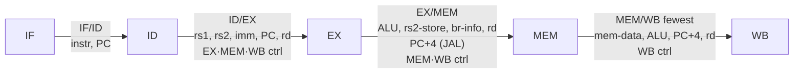

# Lec 4.3: Pipelined Implementation

## Exam Facts

 ==**4 pipeline registers between the 5 stages**==; each register carries data + the **control signals destined for downstream stages**. Control is decoded **once in ID** and rides along — ==**WB-stage ctrl (`rd, RegWr, WBSel`) travels all the way to MEM/WB**==.

- ==**Pipeline ↑ throughput, NOT latency**== (latency may even ↑ from reg OH).
  
  - Patterson rule: $\displaystyle T_\text{between instr}^\text{pipe} = \dfrac{T_\text{between\ instr}^\text{nonpipe}}{N}$ 
  - Speedup vs SC: $\dfrac{n\,T_{long}}{(n+N-1)\,T_{stage}} \xrightarrow{n\to\infty} \dfrac{T_{long}}{T_{stage}} \le N$; ==**drain = $N-1$**==.
  - Speedup vs MC ≈ **average CPI** of MC.
  
- ==**4 pipeline registers**==, ==**`MEM/WB` has fewest fields**==:

  | Reg        | Carries                                                      |
  | ---------- | ------------------------------------------------------------ |
  | **IF/ID**  | instr, PC                                                    |
  | **ID/EX**  | `R[rs1], R[rs2]`, imm, PC, `rd`, **EX·MEM·WB ctrl**          |
  | **EX/MEM** | ALU result, `R[rs2]` (store-data), br info, `rd`, **MEM·WB ctrl**, ==**`PC+4` for `JAL`**== |
  | **MEM/WB** | mem-data, ALU result, `PC+4`, `rd`, **WB ctrl** ← ==**fewest**== |

- ==**Control decoded in ID, carried in pipeline regs to consumer stage**==:

  | Consumer | **EX** (1 cy ahead)              | **MEM** (2 cy ahead) | **WB** (3 cy ahead) |
  | -------- | -------------------------------- | -------------------- | ------------------- |
  | Signals  | `Asel, Bsel, ALUOp/ALUSel, BrUn` | `MemRW, PCSrc`       | `RegWr, WBSel, rd`  |

  > ❌ `ALUSel` does NOT reach MEM/WB (dies after EX). `BrEq/BrLT` are BranchComp **data** outputs in EX, not ID-decoded ctrl.

- ==**Regfile trick**==: `write` **1st half** of clock / `read` **2nd half** → **same-cycle WB→ID forwarding, no extra mux**.

- **Multi-instr in-flight**:

  | Q                  | Source instr | Held in    |
  | ------------------ | ------------ | ---------- |
  | **`rd` write addr**| WB-stage     | **MEM/WB** ←  `IF/ID.rd` ❌ |
  | **imm**            | EX-stage     | **ID/EX**  |
  | **`rs1/rs2` data** | EX-stage     | **ID/EX**  |

- ==**Long-latency ops**== (mul/div/FP) — **2 options**:
  
  1. **Stall** at EX/ID until done.
  2. **Separate iterative or pipelined FU** → younger ops continue.
  
- ==**Retire in-order at WB**== ⇒ precise arch state. Even if younger `add` finishes before older `div`, ==**it waits at WB**==.
  - RV has **no int arith exceptions** ⇒ ==**OoO retirement viable**== (no older int trap can stomp younger commit).

- ==**Pipeline-friendly RV ISA**==: fixed 32-bit + regular `rs1/rs2/rd` positions + load/store-only memory + simple ALU.

- **Pipelining is everywhere**: DRAM, cache, FPU, GPU, network.

## 1. Five Stages & Pipeline Registers

| Stage    | **IF**         | **ID**                       | **EX**          | **MEM**  | **WB**     |
| -------- | -------------- | ---------------------------- | --------------- | -------- | ---------- |
| **Work** | fetch + nextPC | decode, read regs, imm, ctrl | ALU / addr / br | DMem R/W | write `rd` |

==**Last useful stage**== (in pipeline, **all 5 still occupied** — idle stages just pass through):

| Ends @       | Types                                | Reason                       |
| ------------ | ------------------------------------ | ---------------------------- |
| **EX**  (3)  | B (`beq, bne, blt …`)                | compare + branch done in EX  |
| **MEM** (4)  | S (`sw, sh, sb`)                     | DMem write done, no `rd`     |
| **WB**  (5)  | R, I-ALU, J (`jal`), U (`lui auipc`) | ALU/PC+4 → `rd`              |
|              | I-Load (`lw, lh, lb, lbu, lhu`)      | MEM read → WB writes `rd`    |

> [!IMPORTANT]
> ==**`JAL` uses EX/MEM to pass `PC+4` forward**== through MEM/WB so the return address can be written to `rd` at WB.

## 2. Timing: SC vs MC vs Pipeline

Stage delays: regfile R/W = 100 ps; IMem / ALU / DMem = 200 ps.

| Design                  | **Single-cycle**  | **Multi-cycle**   | **5-stage Pipeline**   |
| ----------------------- | ----------------- | ----------------- | ---------------------- |
| **Clock**               | **slowest instr** | **slowest stage** | slowest stage + reg OH |
| **Value**               | `lw` = 800 ps     | 200 ps            | 200 ps + OH            |
| **CPI**                 | 1                 | 3 – 5             | ≈ 1 (+ hazards)        |
| **Latency** (one `lw`)  | 800 ps            | 1000 ps           | 1000 ps                |
| **Throughput** (steady) | 1 / 800 ps        | variable          | 1 / 200 ps **(4× SC)** |

> [!IMPORTANT]
> Pipeline **latency ≥ SC latency** — pipeline wins on **throughput**, not latency. SC has lower per-instr latency but a slow clock locked to the slowest instr.

## 3. Why RV ISA Pipelines Well

- ==**Fixed 32-bit fetch**== → 1-cy IF (vs x86 1–17 B variable).
- ==**Fixed `rs1/rs2/rd` positions**== → regfile read starts in early ID.
- ==**Load/store-only memory**== → only MEM touches DMem; addr-calc in EX (3), mem in MEM (4).
  > Memory-operand ISAs (x86) need extra EX/MEM stages.
- **Simple ALU + addressing** → clean EX.

> [!NOTE] 
>
> ==**Pipeline Lessons**==
>
> - Rate limited by **slowest stage**; imbalance limits speedup.
> - Multiple tasks run on **different resources** simultaneously.
> - Ideal speedup = N stages; fill/drain reduces it.
> - Avoid bubbles from data / control deps.

> Example:
>
> 

## 4. Long-Latency Ops & Retirement (Precise State)

==**mul / div / FP**== 2 options:

1. ==**Stall**== at EX/ID until done (simple, costly).
2. ==**Separate iterative or pipelined FU**== → younger ops continue (e.g. FP).

==**Precise trap requirement**==: arch state must look as if **all older completed + no younger completed**.

> [!IMPORTANT]
> ==**In-order retirement at WB**== → even if younger `add` finishes earlier than older `div`, it **waits at WB** before updating arch state.
> RV has **no int arith exceptions** → no older int instr can trap after a younger one commits ⇒ ==**OoO retirement viable**==.
